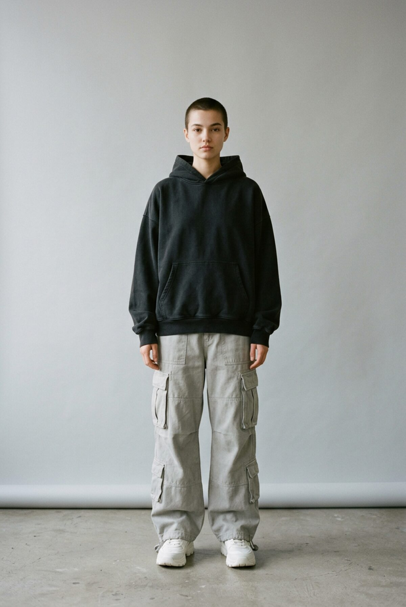

# hekey

Storefront for **hekey**, a heavyweight streetwear label from St. Gallen.



## Design

Built on an editorial "gallery wall" system (reference: [Refero — Acne Studios style](https://styles.refero.design/style/234e9a17-236d-4446-9d58-f83f6806d012)):

- White canvas, full-bleed photography, zero-gutter grids
- 11px uppercase labels with 0.033em tracking for all UI text
- Electric cobalt `#0018a8` only for interaction states, never as a filled button
- No shadows, no radii, no cards. Whitespace does the separating
- Oversized `hekey` wordmark (Manrope) across the split hero and footer

## Features

- 50/50 split hero, links into filtered shop
- 4-column product grid (3 on tablet, 2 on phone) with category filters
- Product drawer with size selection and sold-out sizes
- Bag drawer with quantities, free-shipping threshold, persisted in `localStorage`
- Lookbook strip, values section, newsletter sign-up
- Responsive down to 375px, respects `prefers-reduced-motion`

Checkout and newsletter are front-end placeholders. There is no backend yet.

## Run locally

Plain HTML/CSS/JS, no build step:

```bash
python3 -m http.server 4173
```

Then open http://localhost:4173.

## Structure

```
index.html      markup
styles.css      design tokens + layout
app.js          catalogue, filters, drawers, bag
assets/img/     product, hero and lookbook images (AI-generated)
```

Edit products in the `PRODUCTS` array at the top of `app.js`.
